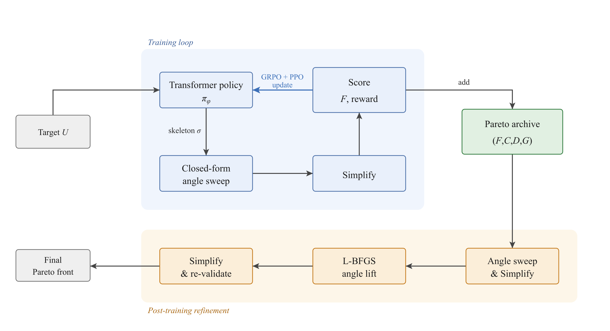

# Unitary Synthesis with Generative Sequence Models

Compiles a target unitary into a circuit over the gate set `{Rz, Ry, CNOT}`
using as few CNOTs as possible. A decoder-only transformer trained by GRPO
searches over discrete circuit *structures*, while the continuous rotation
*angles* of every structure are set by classical optimisation: a closed-form
coordinate sweep inside every rollout and an L-BFGS lift after training. The
output for a target is a Pareto archive of circuits over (infidelity, CNOT
count), from which the most compact circuit at a chosen fidelity is read off.
The implementation is PyTorch and NumPy, in one flat directory.

## The problem

A target `U` on `n` qubits (`d = 2^n`) is to be reproduced by a circuit `V`
of gates from `{Rz, Ry, CNOT}`. Accuracy is the process fidelity

```
F(V; U) = |Tr(U† V)|² / d²            (1 for V = U up to a global phase)
```

and cost is the CNOT count `C`. For an unstructured (Haar-random) target the
count needed lies in a band fixed by `n`:

```
L_SMB(n) = ⌈(4ⁿ − 3n − 1) / 4⌉                      lower bound
L_QSD(n) = ⌈(23/48)·4ⁿ − (3/2)·2ⁿ + 4/3⌉             count of the exact Quantum Shannon Decomposition
```

| n | tokens \|V\| = n² + n + 3 | [L_SMB, L_QSD] |
|---|---|---|
| 2 | 9 | [3, 3] |
| 3 | 15 | [14, 20] |
| 4 | 23 | [61, 100] |
| 5 | 33 | [252, 444] |

The search is confined to this band; the goal is to push each target's count
as far down it as that target allows.

## The method



*The two-phase pipeline: a training loop that searches over circuit
structures, followed by post-training refinement of the archived circuits. An
archive entry stores a circuit's gates, its fidelity F, two-qubit count C,
depth D and gate count G.*

The pipeline has two phases. In the **training** phase the policy proposes
circuit skeletons (structures whose angles are not yet set); each skeleton is
scored by fitting its angles and measuring fidelity and cost; the scores update
the policy and populate a Pareto archive of the non-dominated circuits seen so
far, so the best circuits survive as the policy moves on. In the
**post-training** phase every archived circuit is refined, its angles pushed
toward the best attainable for its structure and its gate count reduced by
algebraic simplification, and the archive is re-validated against the refined
metrics before the reported circuit is selected from it.

The policy is trained from scratch for every target and never sees the target
unitary; the reward alone shapes it.

## Circuits as token sequences

The policy emits tokens from a vocabulary of `n² + n + 3` entries: a rotation
token `Rz(q)` and `Ry(q)` for every qubit `q`, a `CNOT(c, t)` token for every
ordered pair of distinct qubits, and the control tokens `BOS` (fixed first
token), `STOP` (end of the circuit) and `PAD` (fills the rest of the window).
A circuit is the sequence `BOS, g₁, …, g_k, STOP, PAD, …` with the gates in
execution order. Tokens carry no angles: every rotation token gets its angle
from the angle optimiser, never from the policy.

## Algorithms

Throughout, `σ` is a skeleton, `θ` its angle vector, `V(σ, θ)` the circuit
unitary, `C(σ)` its CNOT count and `F` the fidelity to the target `U`. The
hyperparameter names are the fields of `Config` in `config.py`.

### Algorithm 1 · Compile (`compile.py`)

```
procedure Compile(target U)
    φ ← initialise the policy;  P ← ∅
    for t = 1 … max_epochs:
        (φ, P) ← TrainingIteration(φ, U, P)                          Algorithm 2
    for stage in [Sweep with K = post_sweeps, Simplify, L-BFGS, Simplify]:
        apply the stage to every (σ, θ) in P                         Algorithms 4, 5, 6
        P ← ParetoFront(P)                                           re-validate the front
    return P
```

The sweep and L-BFGS stages keep their new angles only where they do not lower
(sweep) or strictly raise (L-BFGS) the fidelity.

### Algorithm 2 · TrainingIteration (`train.py`)

```
procedure TrainingIteration(policy φ, target U, archive P)
    for i = 1 … group_size:
        σᵢ ← Sample(φ)                                               Algorithm 3
        (θᵢ, Fᵢ) ← Sweep(σᵢ, U, K = inner_sweeps)                    Algorithm 4
        σᵢ ← Simplify(σᵢ)                                            Algorithm 5: canonical form
        cᵢ ← cost(Fᵢ, C(σᵢ))                                         cost.py
    φ ← GrpoUpdate(φ, {(σᵢ, cᵢ)})                                    grpo.py
    P ← UpdateArchive(P, {(σᵢ, θᵢ, Fᵢ)})                             archive.py
    return φ, P
```

Every sampled skeleton is canonicalised before it is scored, so the CNOT
count entering the cost and the archive is that of the simplified skeleton.

### Algorithm 3 · Sample (`policy.py`)

```
function Sample(policy φ)
    t ← (BOS)
    while t has no STOP and |t| < W:                                 W: the context window
        ℓ ← logits of π_φ(· | t);  apply the masks below to ℓ
        draw the next token from softmax(−β ℓ);  append it to t
    return the skeleton σ decoded from t, with a uniform angle in [−π, π] per rotation
```

The policy is a decoder-only transformer: token and position embeddings,
`n_layer` pre-norm blocks of masked self-attention and a GELU feed-forward
network, a final layer norm, and an output layer that reuses the token
embedding. `β` is the sampling inverse temperature (small `β` explores, large
`β` exploits). Before each draw the logits are masked; a masked token has
probability zero, and the same masked distribution is used when the policy
is scored in the GRPO update:

* `BOS` and `PAD` are never sampled, and `STOP` is blocked at the first
  position, so no circuit is empty.
* **R1, rotation merge:** a rotation token is blocked if the last gate on its
  qubit is the same rotation token (the pair would merge into one rotation).
* **R2, CNOT involution:** a CNOT token is blocked if the last gate on both of
  its qubits is that same CNOT (the pair cancels).
* **CNOT band:** no CNOT once `C ≥ L_QSD`, and no `STOP` until `C ≥ L_SMB`,
  so every circuit satisfies `L_SMB ≤ C ≤ L_QSD`.

The window is `W = min(max_context_tokens − 1, 7.5·L_SMB(n))` action
positions, at least 32, plus the `BOS` position.

### Algorithm 4 · Sweep (`sweep.py`)

With every other angle held fixed, the fidelity is a single-frequency
sinusoid in the angle `θ_p` of the rotation at position `p`, whose generator
is the Pauli `P_p`. Writing `L` for the product of the gates before `p` and
`R` for the product of the gates after it,

```
Tr(U† V) = cos(θ_p/2)·A − i sin(θ_p/2)·B,     A = Tr(L U† R),   B = Tr(L U† R P_p)
|Tr(U† V)|² = (|A|² + |B|²)/2 + (|A|² − |B|²)/2 · cos θ_p + Im(Ā B) · sin θ_p
θ_p* = atan2(2 Im(Ā B), |A|² − |B|²)                                  the exact maximiser
```

```
function Sweep(skeleton σ, angles θ, target U, passes K)
    for K passes:
        R ← G_m ⋯ G_2;  L ← I                                        gates with the angles entering the pass
        for each position p = 1 … m, left to right:
            if gate p is a rotation:
                A ← Tr(L U† R);  B ← Tr(L U† R P_p)
                θ_p ← atan2(2 Im(Ā B), |A|² − |B|²)
            L ← G_p(θ_p) L;  R ← R G_{p+1}†                          new gate on the left, old gate peeled on the right
    return θ and F(V(σ, θ); U)
```

Each update is the global maximum over one angle with the others fixed, so a
pass never lowers the fidelity; updated angles are used immediately within the
pass (Gauss–Seidel). Inside training the sweep starts from the uniform random
angles of Algorithm 3; after training it restarts from the archived angles.

### Cost (`cost.py`)

```
cost(F, C) = max(C − L_SMB, 0) / ΔL  +  sqrt(max(1 − F, 0)) / sqrt(1 − fidelity_target),      ΔL = L_QSD − L_SMB + 1
reward = −cost
```

The first term charges one unit for traversing the whole feasible band, so
both terms sit on the same scale at every `n`; the second is one unit at
`F = fidelity_target` and its slope grows without bound as `F → 1`, sharpening
the approach to each structure's fidelity ceiling.

### GRPO update (`grpo.py`)

For a group of `N = group_size` rollouts with costs `cᵢ`, mean `c̄` and sample
standard deviation `s`:

```
Aᵢ = (c̄ − cᵢ) / (s + 1e−8)                                           group-relative advantage
ρᵢ(φ) = exp( (1/mᵢ) Σⱼ [ log π_φ(tᵢⱼ | tᵢ,<ⱼ) − log π_old(tᵢⱼ | tᵢ,<ⱼ) ] )   length-normalised likelihood ratio
                                                                     (mᵢ sampled tokens, same masks and β as at sampling)
L(φ) = −(1/B) Σᵢ min( ρᵢ Aᵢ,  clip(ρᵢ, 1 − ε, 1 + ε) Aᵢ )             ε = clip_ratio
```

A positive advantage marks a circuit that beat its group. Each group is
reused for `inner_passes` passes in mini-batches of `batch_size`, so an
iteration takes `inner_passes · N / batch_size` steps of AdamW (`lr`,
`weight_decay`) with the gradient clipped to `grad_norm_clip` in global norm.

The inverse temperature follows a cyclic cosine schedule with a period of half
the run, two full cycles: `β₀ = (β_min + β_max)/2` and, for iteration `t ≥ 1`,

```
β_t = (β_max + β_min)/2 − (β_max − β_min)/2 · cos(2π t / ⌊max_epochs / 2⌋)
```

### Pareto archive (`archive.py`, `revalidate.py`)

A candidate `σ'` dominates `σ` when

```
F' ≥ F,   C' ≤ C,   D' ≤ D,   G' ≤ G,   with at least one strict,   and |F' − F| > fidelity_tol
```

where `D` is the circuit depth and `G` the total gate count. Fidelities
within `fidelity_tol` count as tied, so neither circuit dominates the other. A
candidate is admitted only if `F ≥ fidelity_floor`; circuits with the same
canonical gate stream are kept once, preferring the one with the higher
fidelity and then the more compact; past `max_archive_size` the entry in the
most crowded region of objective space is dropped.

```
UpdateArchive(P, candidates):  P ← the non-dominated subset of P ∪ {admissible candidates}
ParetoFront(P):                UpdateArchive(∅, P), i.e. the front recomputed from the refined entries
```

### Algorithm 5 · Simplify (`simplify.py`)

```
function Simplify(skeleton σ, as a gate list)
    repeat
        scan the gates left to right, applying the first matching rule
    until no rule fires in a full pass
    return σ
```

1. Merge consecutive same-axis rotations on a qubit: `R(a) R(b) = R(a + b)`.
2. Cancel consecutive identical CNOTs: `CNOT(c,t) CNOT(c,t) = I`.
3. Remove rotations with `|θ| < angle_tol`.
4. Reduce every angle to `(−π, π]`; a shift by `2π` is a global phase.
5. Move an `Rz` rightward past the control of a CNOT (both are diagonal), which
   creates new opportunities for rules 1 to 3.

"Consecutive" means adjacent on the qubits involved: the scan looks back past
gates on other qubits. Rules 1 to 3 strictly reduce the gate count, rule 4 is
idempotent and rule 5 acts at most once per rotation and CNOT, so the loop
terminates; the rules are exact identities, so the fidelity is unchanged.

### Algorithm 6 · L-BFGS (`lbfgs.py`)

```
function L-BFGS(skeleton σ, angles θ, target U)
    J(θ) = 1 − F(V(σ, θ); U)
    run lbfgs_steps iterations of limited-memory BFGS on J, with ∇J by automatic differentiation through the circuit
    return θ and F(V(σ, θ); U)
```

The sweep is exact per coordinate but cannot leave a stationary point of the
joint objective where no single-angle move helps; a quasi-Newton step on the
whole angle vector can. Every archived circuit is an independent problem, so
the archive is optimised as a batch in which each circuit keeps its own
curvature history (`lbfgs_memory` pairs) and step length (a backtracking
Armijo line search of at most `lbfgs_line_search_steps` halvings).

## Layout

Each file is one box of the figure above; `config.py` holds every
hyperparameter and `helpers.py` everything shared.

| File | Box in the figure | Defines |
|---|---|---|
| `compile.py` | the whole pipeline; the entry point | Algorithm 1 |
| `target.py` | Target U | a Haar-random unitary drawn from a seed |
| `train.py` | Training loop | Algorithm 2 and the β schedule |
| `policy.py` | Transformer policy | Algorithm 3, the network and the masks |
| `sweep.py` | Closed-form angle sweep (in the loop and in post-training) | Algorithm 4 |
| `cost.py` | Score | the cost formula |
| `grpo.py` | GRPO + PPO update | advantages, clipped loss, optimiser step |
| `archive.py` | Pareto archive | dominance test and UpdateArchive |
| `simplify.py` | Simplify | Algorithm 5 |
| `lbfgs.py` | L-BFGS angle lift | Algorithm 6 |
| `revalidate.py` | re-validate (with the final Simplify) | ParetoFront |
| `config.py` | | every hyperparameter |
| `helpers.py` | | device and precision defaults, `L_SMB` and `L_QSD`, the token vocabulary, the circuit evaluator (`V(σ, θ)` and `F`) |

## Setup

```bash
python -m venv .venv
./.venv/bin/pip install -r requirements.txt
```

The code uses the GPU when one is visible, in single precision, and otherwise
the CPU in double precision. pip's default Linux wheel of `torch` includes
CUDA; for another CUDA version or a CPU-only build, install `torch` as
described at pytorch.org first.

## Usage

Compile one Haar-random target with the default configuration (50 iterations,
group size 256, a policy of 6 layers, 6 heads and width 384):

```bash
python compile.py --n-qubits 3 --target-seed 46
```

A quick check, which takes about a minute on a CPU and already reaches `F = 1`
with three CNOTs:

```bash
python compile.py --n-qubits 2 --target-seed 1 --max-epochs 3
```

| Flag | Meaning | Default |
|---|---|---|
| `--n-qubits` | qubit count n | 2 |
| `--target-seed` | seed of the Haar-random target | 1 |
| `--max-epochs` | training iterations | 50 |
| `--output-dir` | where artifacts are written | `runs` |

The run prints one line per iteration (inverse temperature, loss, mean cost,
the group's best fidelity with its CNOT count, the best fidelity so far,
archive size, time), then the most compact circuit of the final front at each
operating point `F = 1`, `F ≥ 0.9999` and `F ≥ 0.999`, and the best-fidelity
circuit. Fidelities are stored in single precision, so `F = 1` means a stored
fidelity of exactly 1.

Artifacts land in `<output-dir>/n<n>_seed<seed>/`:

| File | Contents |
|---|---|
| `run.json` | `config`; the bounds `L_SMB` and `L_QSD`; the token `vocabulary`; `wall_time_sec`; the per-iteration `training_log` (loss, inverse temperature, cost and fidelity statistics, archive statistics, timings); and `pareto_front`, every circuit of the final front with its `fidelity`, `cnot_count`, `depth`, `total_gates`, `epoch`, `tokens` (BOS-prefixed) and `angles` (one per token after BOS) |
| `target_unitary.npy` | the target, a complex `2^n × 2^n` array |

## Configuration

Every hyperparameter is a field of `Config` in `config.py`. Editing a field
changes the method, not just the run, except `fidelity_threshold` and
`report_thresholds`, which only affect what is logged and printed, and
`lbfgs_chunk`, which only bounds the autograd memory of the L-BFGS stage by
refining the archive in chunks.

| Group | Setting | Default |
|---|---|---|
| Target | `num_qubits`, `target_seed`; `training_seed` (policy initialisation, sampling, mini-batch order) | 2, 1; 42 |
| Policy network | `n_layer`, `n_head`, `n_embd` (feed-forward width `4·n_embd`) | 6, 6, 384 |
| | `max_context_tokens` (cap on the window), `init_stddev`, `layer_norm_eps` | 2048, 0.02, 1e-5 |
| GRPO training | `max_epochs`, `group_size`, `batch_size`, `inner_passes` | 50, 256, 16, 4 |
| | `lr`, `weight_decay`, `grad_norm_clip`, `clip_ratio` | 3e-4, 0.01, 1.0, 0.2 |
| Inverse temperature | `beta_min`, `beta_max` | 0.6, 1.4 |
| In-rollout sweep | `inner_sweeps` | 20 |
| Reward and archive | `fidelity_target`, `fidelity_floor`, `fidelity_tol`, `max_archive_size` | 0.999, 0.7, 1e-4, 200 |
| Post-training | `post_sweeps`, `lbfgs_steps`, `lbfgs_memory`, `lbfgs_line_search_steps`, `lbfgs_chunk` | 100, 200, 10, 20, 64 |
| Simplify | `angle_tol` | 1e-9 |
| Reporting | `fidelity_threshold`, `report_thresholds` | 0.99; `1 − 1e-9`, 0.9999, 0.999 |

## Benchmark protocol

The method is evaluated on Haar-random targets: fifty targets (seeds 1 to 50)
at each `n ∈ {2, 3, 4, 5}`, one `compile.py` invocation per `(n, seed)`, with
the training seed held fixed so that variation between runs reflects the
target alone. Per target, the circuits reported are the most compact ones at
`F = 1` and at `F ≥ 0.9999`; the per-`n` figures are means over the fifty
targets.
